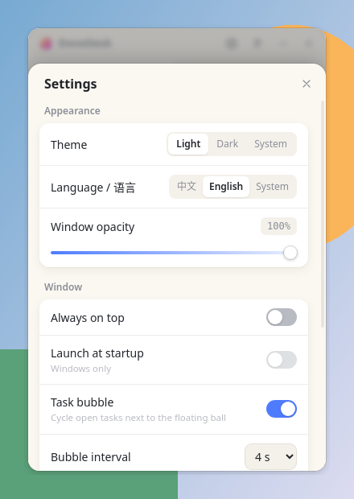

  
  <h1>DoneDesk</h1>
  
<b>A lightweight sticky-note todo app for the Windows desktop.</b> 轻巧的 Windows 桌面任务便签 —— 今日事，今日毕。

  
  
  
  
  
<a href="README.md">中文</a> | <b>English</b>

  
<a href="https://github.com/gu-success/donedesk/releases/download/v1.1.1/DoneDesk-Setup-1.1.1.exe"><b>⬇️ Download for Windows (v1.1.1)</b></a>

  

> The app UI supports **English and Chinese** (switch in Settings; defaults to your system language).

## ✨ Features

- 🌐 **English & Chinese UI** — switch in Settings; follows your system language by default. (v1.1)
- 🫧 **Window opacity** — 30%–100%, applied live; the background turns translucent while text stays crisp. (v1.1)
- 🟦 **Rounded window** — new rounded frameless look with a subtle border and shadow; resize from any edge. (v1.1)
- ⚙️ **Settings button** — a gear next to the pin button opens the settings panel. (v1.1)
- 🟡 **Floating ball + task bubble** — when minimized, a draggable ball shows your open-task count, and a chat-style bubble cycles through open tasks. Click to restore; right-click for Restore / Quit. (v1.1)
- ↕️ **Redesigned drag & drop** — lifted card, dashed placeholder and smooth reflow animation. (v1.1)
- 📋 **Today's tasks** — opens straight to today's list, with date and progress at the top.
- ✅ **Strike-through on done** — completed tasks get crossed out.
- 🔁 **Auto carry-over** — unfinished tasks automatically move to the next day.
- 🔴 **Urgent & pinned** — end a task with `*` to mark it urgent: shown in red and pinned to the top.
- ↕️ **Drag to reorder.**
- 🗓️ **Recurring todos** — daily / weekly (multiple weekdays) / monthly (clamped to the last day for short months); optional time reminder with system notification; the next occurrence is created automatically without stacking duplicates.
- ⌨️ **Global hotkey** — `Ctrl+Shift+L` shows / hides the window.
- 🔒 **Encrypted notes** — scrypt + AES-256-GCM, auto-lock on idle, lock on system lock, brute-force cooldown.
- 🌗 **Themes** — light / dark / follow system.
- 🪟 **Desktop niceties** — frameless custom title bar, always-on-top, system tray, start with Windows, single instance.
- 💾 **Local-only data** — stored in `%APPDATA%\DoneDesk` with atomic writes and a `.bak` backup.

## 📸 Screenshots

| Tasks (light) | Tasks (dark, English) |
|:---:|:---:|
|  |  |
| **Settings (light)** | **Settings (dark)** |
|  |  |
| **55% opacity (light)** | **55% opacity (dark)** |
|  |  |
| **Dragging a task** | **Chinese UI** |
|  |  |

**Floating ball & task bubble (when minimized)**

 

## 📥 Download & Install

1. Go to [Releases](https://github.com/gu-success/donedesk/releases/latest) or download **[DoneDesk-Setup-1.1.1.exe](https://github.com/gu-success/donedesk/releases/download/v1.1.1/DoneDesk-Setup-1.1.1.exe)** directly.
2. Run the installer.
3. Requirements: **Windows 10 / 11 (x64)**.

> [!NOTE]
> The installer is not code-signed yet, so Windows SmartScreen may show "Windows protected your PC". Click **More info → Run anyway** (更多信息 → 仍要运行).

## ⌨️ Shortcuts & Tips

| Action | How |
|---|---|
| Show / hide window | `Ctrl` + `Shift` + `L` |
| Add a task | Type in the bottom box and press `Enter` |
| Mark urgent | End the task with `*` (or click the star) |
| Reorder | Drag a task |

## 🔒 Privacy & Security

- **No network, no account** — all data stays in `%APPDATA%\DoneDesk` on your PC.
- **Encryption** — notes are encrypted with **AES-256-GCM** using a key derived via **scrypt**.
- **Auto-lock** — after 1 / 5 / 15 / 30 / 60 minutes idle or never (default 15); locks immediately when Windows locks.
- **Brute-force protection** — 5 wrong attempts trigger a 30-second cooldown.
- **Safe writes** — atomic writes plus a `.bak` backup.

> [!WARNING]
> The notes password **cannot be recovered**. If you forget it, the encrypted notes cannot be decrypted.

## ❓ FAQ

<b>Why does Windows say "Windows protected your PC"?</b>

The installer isn't code-signed yet. Click "More info" → "Run anyway". Code signing is on the roadmap.

<b>Where does the app go when I close the window?</b>

It hides to the system tray. Press `Ctrl+Shift+L` or click the tray icon to bring it back; quit from the tray menu.

<b>Where is my data? How do I back it up?</b>

In `%APPDATA%\DoneDesk`. Copy that folder to back it up.

<b>I forgot my notes password.</b>

By design it can't be recovered, and neither can the encrypted content.

<b>macOS / Linux?</b>

Currently Windows 10/11 x64 only. A macOS build is planned.

## 🗺️ Roadmap

- [ ] History view (see tasks completed on past days)
- [ ] Auto-update
- [ ] Code-signed installer
- [ ] macOS build

## 💬 Feedback

Found a bug or have an idea? Please open an [Issue](https://github.com/gu-success/donedesk/issues/new/choose). If you like it, a ⭐ Star is appreciated!
