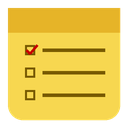
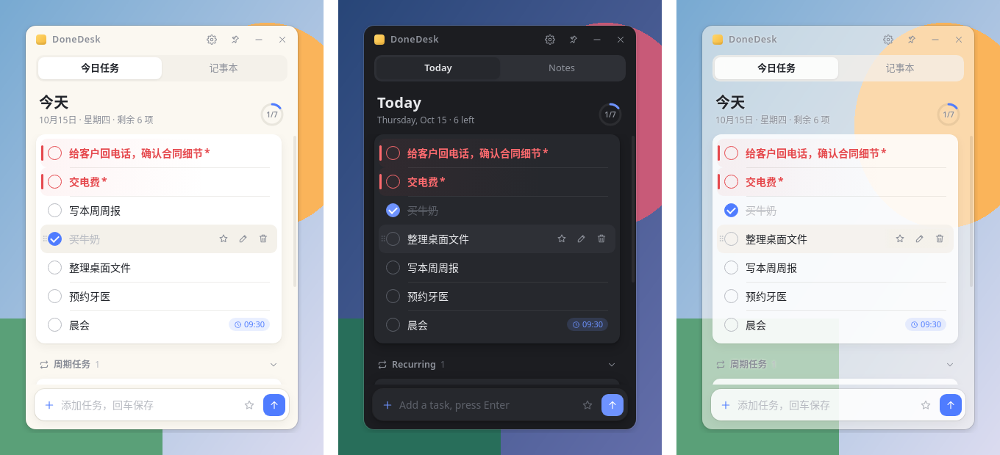
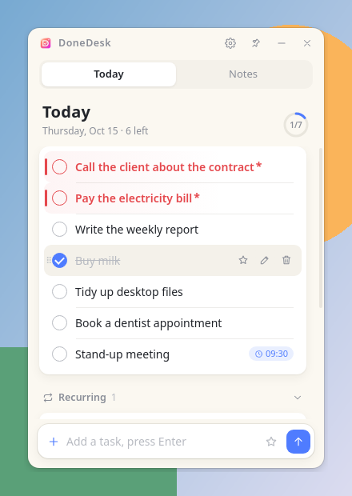
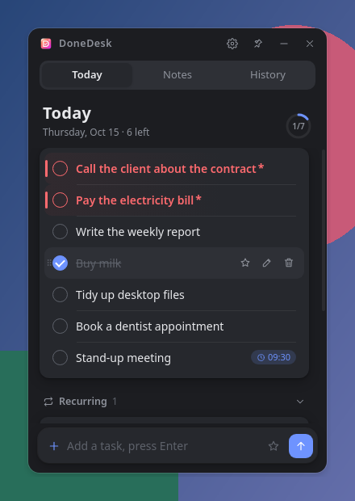
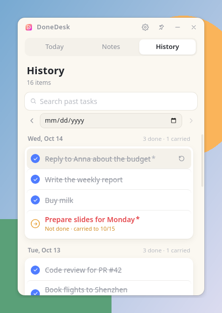
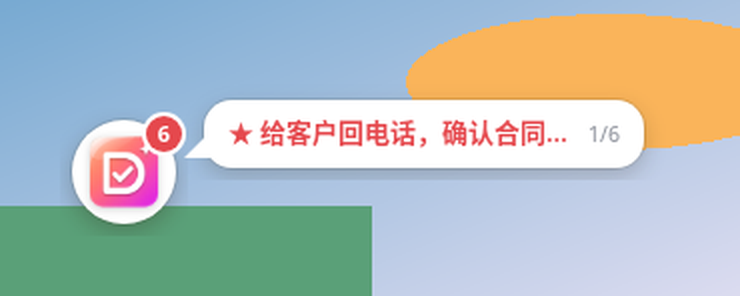

  
  <h1>DoneDesk</h1>
  
<b>A lightweight sticky-note todo app for your desktop.</b> Windows · macOS · Linux

  
  
  
  
  
<a href="README.md">中文</a> | <b>English</b>

  
<a href="https://github.com/gu-success/donedesk/releases/latest"><b>⬇️ Download the latest release</b></a>

  

## ✨ Features

- 🔁 **Auto carry-over** — unfinished tasks roll over to the next day automatically.
- ✅ **Done & urgent** — check to strike through; star (or end with `*`) to mark urgent and pin to top.
- 🗓️ **Recurring tasks** — daily / weekly / monthly, with optional time reminders.
- 🟡 **Floating ball + task bubble** — when minimized, a ball shows your open-task count and a bubble cycles through them.
- 🔒 **Encrypted notes** — password-protected, AES-256-GCM, local-only, auto-lock on idle.
- 🕘 **History** — browse past days, search, and restore any task to today.
- 🎨 **Make it yours** — light/dark themes, window opacity, UI fonts, English / Chinese.

## 📸 Screenshots

| Today | Dark theme | History |
|:---:|:---:|:---:|
|  |  |  |

 Floating ball & task bubble

## 📥 Download

Grab the package for your platform from [Releases](https://github.com/gu-success/donedesk/releases/latest):

| Platform | Package |
|---|---|
| Windows 10/11 (x64) | [DoneDesk-Setup-1.1.4.exe](https://github.com/gu-success/donedesk/releases/download/v1.1.4/DoneDesk-Setup-1.1.4.exe) |
| macOS · Apple Silicon (M1–M4) | [DoneDesk-1.1.4-mac-arm64.dmg](https://github.com/gu-success/donedesk/releases/download/v1.1.4/DoneDesk-1.1.4-mac-arm64.dmg) · [zip](https://github.com/gu-success/donedesk/releases/download/v1.1.4/DoneDesk-1.1.4-mac-arm64.zip) |
| macOS · Intel | [DoneDesk-1.1.4-mac-x64.dmg](https://github.com/gu-success/donedesk/releases/download/v1.1.4/DoneDesk-1.1.4-mac-x64.dmg) · [zip](https://github.com/gu-success/donedesk/releases/download/v1.1.4/DoneDesk-1.1.4-mac-x64.zip) |
| Linux · Debian/Ubuntu (x64) | [donedesk_1.1.4_amd64.deb](https://github.com/gu-success/donedesk/releases/download/v1.1.4/donedesk_1.1.4_amd64.deb) |

Not sure which Mac you have? Apple menu  → About This Mac.

> [!NOTE]
> The builds aren't signed yet. **Windows**: on the SmartScreen prompt click **More info → Run anyway**.
> **macOS**: if it says the developer can't be verified, do one of:
> 1. Right-click DoneDesk in Applications → **Open**;
> 2. **System Settings → Privacy & Security → Open Anyway**;
> 3. Run `xattr -cr /Applications/DoneDesk.app` in Terminal.

## ⌨️ Shortcuts

| Action | Windows / Linux | macOS |
|---|---|---|
| Show / hide window | `Ctrl+Shift+L` | `⌘⇧L` |
| Add a task | `Enter` | `Enter` |
| Mark urgent | End with `*` or click the star | same |
| Quit | Tray menu | `⌘Q` |

## 🔒 Privacy & Security

- **No network, no account** — data stays on your machine (Windows `%APPDATA%\DoneDesk`, macOS `~/Library/Application Support/DoneDesk`, Linux `~/.config/DoneDesk`).
- **Encryption** — scrypt key derivation + AES-256-GCM; auto-locks on idle or screen lock; 30-second cooldown after 5 wrong attempts.
- **Safe writes** — atomic writes plus a `.bak` backup.

> [!WARNING]
> The notes password **cannot be recovered**.

## ❓ FAQ

<b>Which platforms are supported?</b>

Windows 10/11 (x64), macOS (Apple Silicon and Intel), and Linux (Debian/Ubuntu x64 .deb).

<b>Where does the app go when I close the window?</b>

It keeps running in the system tray / menu bar. Use the hotkey or click the tray icon to bring it back.

<b>How do I back up my data?</b>

Copy the data folder listed under Privacy & Security.

## 🗺️ Roadmap

- [ ] Auto-update
- [ ] Code signing / Apple notarization

## 💬 Feedback

Found a bug or have an idea? Open an [Issue](https://github.com/gu-success/donedesk/issues/new/choose). If you like it, a ⭐ Star is appreciated!
