

  
  <h1>DoneDesk</h1>
  
<b>轻巧的 Windows 桌面任务便签 —— 今日事，今日毕。</b> A lightweight sticky-note todo app for the Windows desktop.

  
  
  
  
  
<b>中文</b> | <a href="README.en.md">English</a>

  
<a href="https://github.com/gu-success/donedesk/releases/download/v1.1.3/DoneDesk-Setup-1.1.3.exe"><b>⬇️ 下载 Windows 安装包 (v1.1.3)</b></a>

  

## ✨ 功能特性

- ✏️ **改密已修复**：解锁后或直接输入当前密码即可修改；需确认新密码，成功有明确提示。（v1.1.3）
- 🔁 **底部「+」设周期**：点输入栏左侧 + 弹出周期选项（每天/每周/每月+时间），提交即创建周期任务；星标仍表示紧急。（v1.1.3）
- ➕ **折叠输入栏**：空闲时收成右侧圆形 +，点击展开；点外部或 Esc 收回。（v1.1.3）
- 🔤 **界面字体可选**：设置中切换系统默认 / Segoe UI / 微软雅黑 / 苹方 / Noto / Inter / 等宽。（v1.1.3）
- 🕘 **历史记录** —— 按日期查看过去的任务（新→旧），已完成划线、未完成结转有标记；支持搜索、日期选择与前后翻页，可一键恢复到今天。（v1.1.2）
- 🌐 **中英双语** —— 设置中一键切换中文 / English，默认跟随系统语言。（v1.1）
- 🫧 **窗口不透明度** —— 30%–100% 实时调节，背景半透明、文字依然清晰。（v1.1）
- 🟦 **圆角窗口** —— 全新圆角无边框外观，带细边框与柔和阴影，边缘可拖动缩放。（v1.1）
- ⚙️ **设置入口** —— 标题栏「置顶」旁的齿轮按钮，弹出设置面板。（v1.1）
- 🟡 **悬浮球 + 任务气泡** —— 最小化后显示可拖动的悬浮球（显示未完成数量），旁边像聊天消息一样轮播未完成任务；单击恢复窗口，右键菜单可恢复 / 退出。（v1.1）
- ↕️ **全新拖拽排序** —— 浮起卡片、虚线占位与平滑重排动画。（v1.1）
- 📋 **今日任务** —— 打开即是今天要做的事，顶部显示日期与完成进度。
- ✅ **完成即划线** —— 勾选后任务加删除线，一目了然。
- 🔁 **未完成自动顺延** —— 今天没做完的任务会自动带到第二天，不会丢。
- 🔴 **紧急置顶** —— 任务末尾加 `*` 即标记为紧急：红色显示并置顶。
- ↕️ **拖拽排序** —— 按住拖动即可调整任务顺序。
- 🗓️ **周期任务** —— 支持每天 / 每周（可多选星期）/ 每月（遇到月末自动取当月最后一天）；可设定时间提醒并弹出系统通知；完成后自动生成下一次，不会重复堆积。
- ⌨️ **全局快捷键** —— `Ctrl+Shift+L` 随时显示 / 隐藏窗口。
- 🔒 **加密记事本** —— 使用 scrypt + AES-256-GCM 本地加密，支持闲置自动锁定、系统锁屏时锁定、输错保护。
- 🌗 **主题** —— 浅色 / 深色 / 跟随系统。
- 🪟 **桌面体验** —— 无边框自定义标题栏、窗口置顶、系统托盘、开机自启、单实例运行。
- 💾 **数据完全本地** —— 只保存在 `%APPDATA%\DoneDesk`，原子写入并保留 `.bak` 备份。

## 📸 截图

| 今日任务（浅色） | 今日任务（深色 · English） |
|:---:|:---:|
| 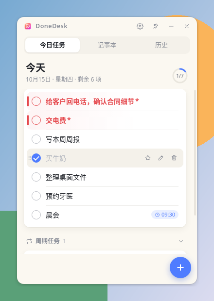 |  |
| **设置面板** | **Settings (English · Dark)** |
| 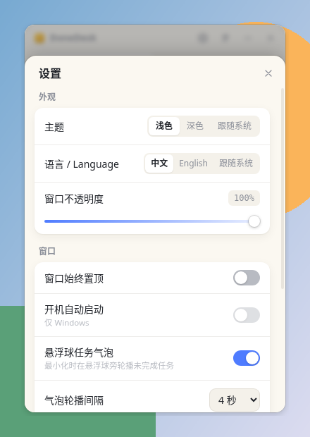 | 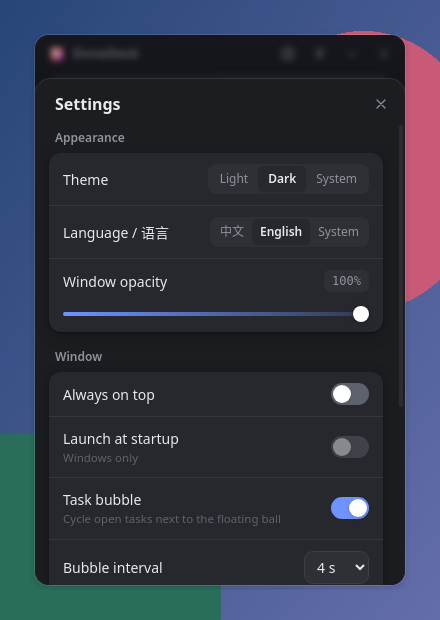 |
| **不透明度 55%（浅色）** | **不透明度 55%（深色）** |
| 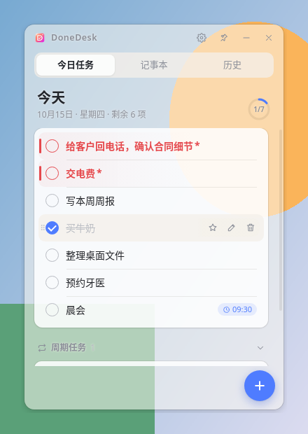 | 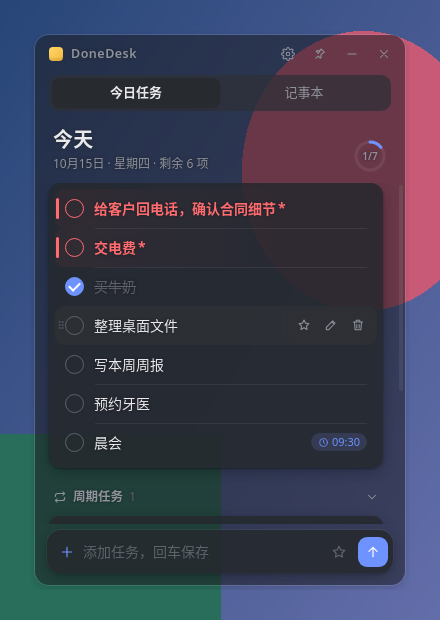 |
| **折叠输入栏** | **周期弹出** |
|:---:|:---:|
| 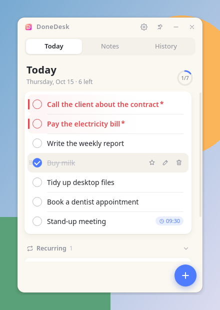 | 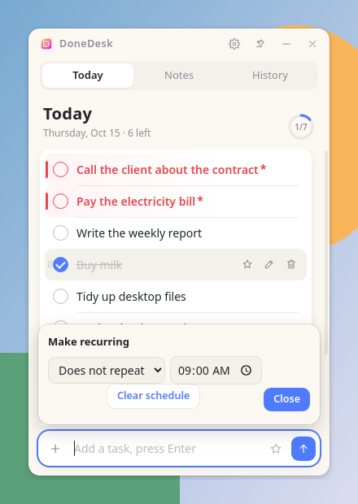 |
| **周期已启用** | **修改密码成功** |
| 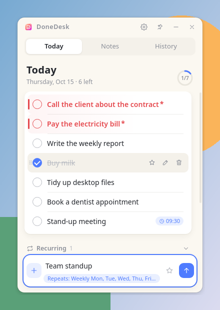 | 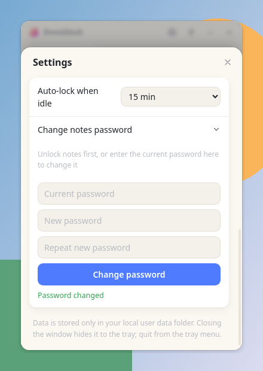 |
| **历史记录（浅色）** | **历史记录（深色）** |
|  | 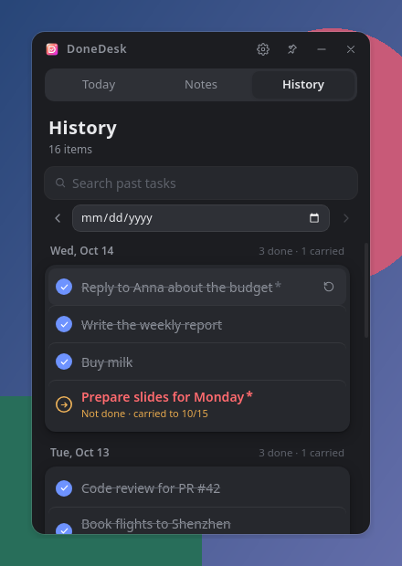 |
| **拖拽排序中** | **English UI** |
| 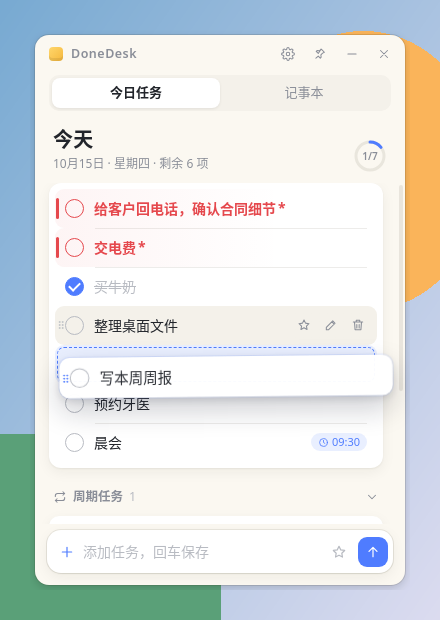 |  |

**悬浮球与任务气泡（最小化时）**

 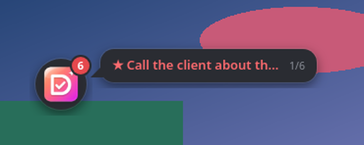

## 📥 下载安装

1. 前往 [Releases](https://github.com/gu-success/donedesk/releases/latest) 或直接下载 **[DoneDesk-Setup-1.1.3.exe](https://github.com/gu-success/donedesk/releases/download/v1.1.3/DoneDesk-Setup-1.1.3.exe)**。
2. 双击运行安装程序。
3. 系统要求：**Windows 10 / 11（64 位）**。

> [!NOTE]
> 安装包暂未进行代码签名，首次运行时 Windows SmartScreen 可能提示“已保护你的电脑”。点击 **「更多信息」→「仍要运行」** 即可。

## ⌨️ 快捷键与小技巧

| 操作 | 方式 |
|---|---|
| 显示 / 隐藏窗口 | `Ctrl` + `Shift` + `L` |
| 添加任务 | 在底部输入框输入后按 `Enter` |
| 标记紧急 | 任务末尾加 `*`（或点击星标） |
| 调整顺序 | 拖拽任务 |

## 🔒 隐私与安全

- **不联网、无账号**：所有数据只保存在本机 `%APPDATA%\DoneDesk`。
- **加密方式**：记事本内容使用 **scrypt** 派生密钥，**AES-256-GCM** 加密存储。
- **自动锁定**：闲置 1 / 5 / 15 / 30 / 60 分钟或从不（默认 15 分钟）；系统锁屏时立即锁定。
- **防暴力尝试**：连续输错 5 次密码需等待 30 秒。
- **数据安全写入**：原子写入 + `.bak` 备份，降低意外断电导致的数据损坏风险。

> [!WARNING]
> 记事本密码**无法找回**。忘记密码将无法解密已有内容，请务必牢记。

## ❓ 常见问题

<b>为什么 Windows 提示“已保护你的电脑”？</b>

安装包尚未购买代码签名证书，SmartScreen 会对未签名程序给出提示。点击「更多信息」→「仍要运行」即可。代码签名已列入计划。

<b>关闭窗口后程序去哪了？</b>

关闭窗口会隐藏到系统托盘；按 `Ctrl+Shift+L` 或点击托盘图标即可重新显示。彻底退出请使用托盘菜单。

<b>数据保存在哪里？如何备份？</b>

在 `%APPDATA%\DoneDesk` 目录。复制该目录即可备份。

<b>忘记记事本密码怎么办？</b>

出于安全设计，密码无法找回，加密内容也无法恢复。

<b>支持 macOS / Linux 吗？</b>

目前仅支持 Windows 10/11 x64，macOS 版本在计划中。

## 🗺️ 路线图

- [ ] 历史记录视图（查看过去每天完成的任务）
- [ ] 自动更新
- [ ] 安装包代码签名
- [ ] macOS 版本

## 💬 反馈

遇到问题或有新想法？欢迎提交 [Issue](https://github.com/gu-success/donedesk/issues/new/choose)。如果觉得好用，点个 ⭐ Star 支持一下吧！
